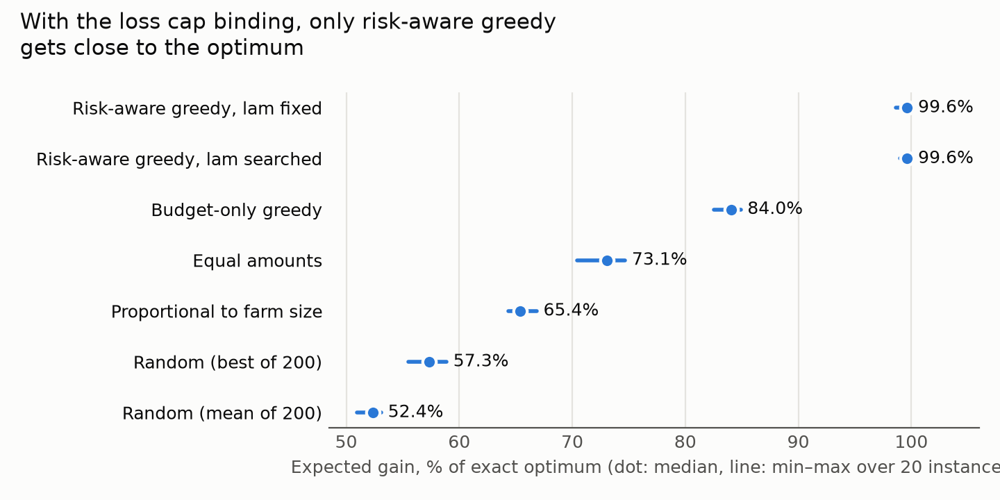
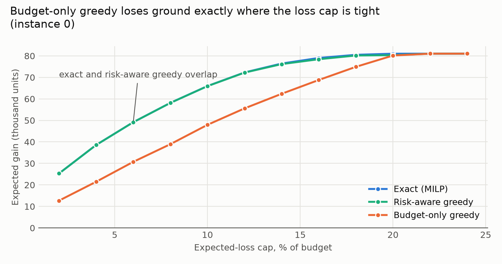
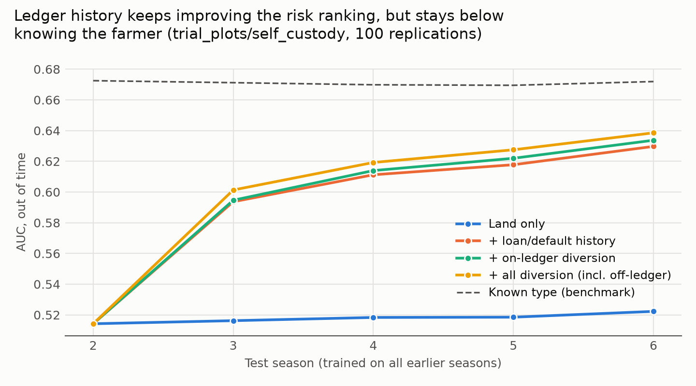
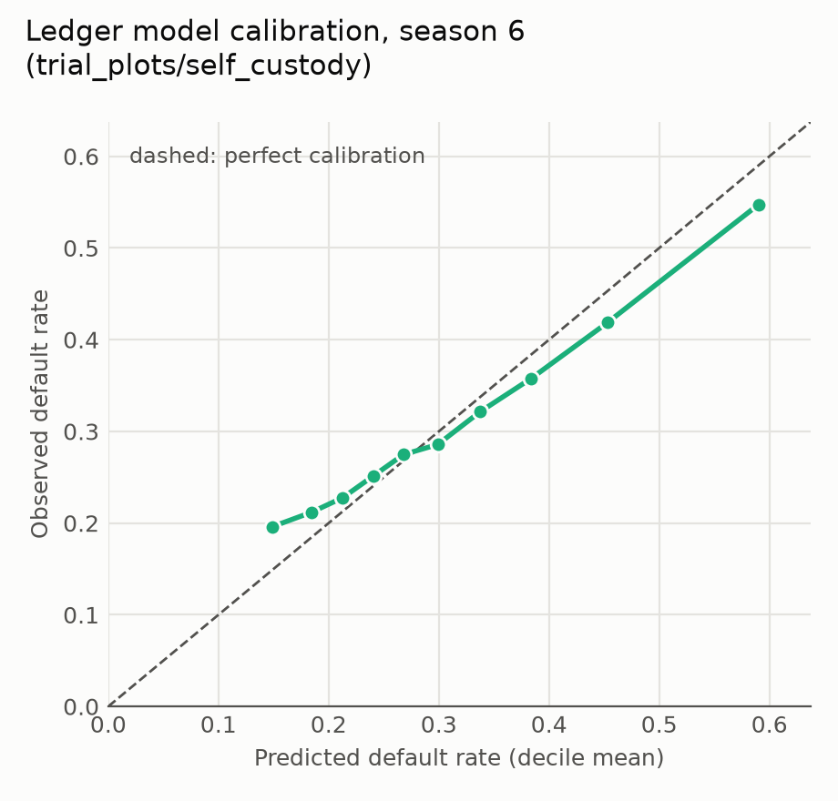
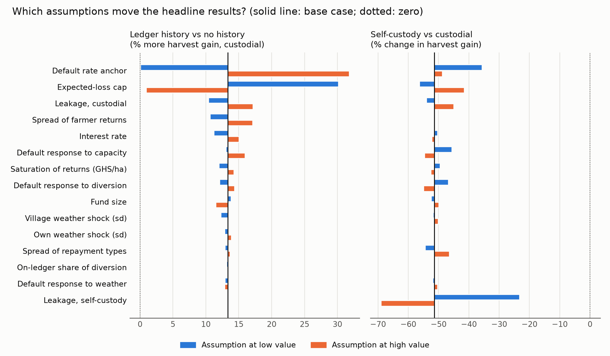

# xrpl-input-credit

Restricted-spend agricultural input credit on the XRP Ledger: which parts of
"credit that can only be spent at approved input vendors" the ledger enforces
at protocol level, which parts fall to key custody and field institutions, and
how much the resulting transaction history improves budget-constrained credit
allocation.

All farmer data in this repository is **synthetic**. Nothing here describes or
makes claims about any deployed system.

**Live explorer: <https://illestalive.github.io/xrpl-input-credit/web/>**

**Research note (8 pages): [`report/main.pdf`](report/main.pdf).** Every number in it is
generated from `results/*.json` by `report/build_numbers.py`.

**Feature-phone channel.** Few smallholder farmers have smartphones, so platforms in the
region reach them over USSD and SMS (Neza, Nyarko & Orozco 2023). A basic phone cannot hold a
key, so a USSD channel means an operator holds it: the custodial case, which is exactly where
the ledger's farmer-side restrictions hold (S4c and S5 need the farmer's signature). The
explorer has a working `*384#` menu (`web/ussd.js`, tested by `web/ussd.test.js`) whose operator
(`web/custodial.js`) turns menu choices into testnet transactions and replies by SMS.

**Interactive explorer: [`web/`](web/).** A static page (no framework, no build step) that
shows the results with scenario and assumption controls, and a *Run on testnet* button that
creates throwaway testnet accounts in the browser and runs the escape routes live with
xrpl.js. The page renders `web/data.json`, built from `results/*.json` by
`web/build_data.py`; it computes nothing itself. Serve the repository root over HTTP and open
`/web/`, e.g. `python3 -m http.server` then <http://localhost:8000/web/>.

## Status

| Part | Content | State |
|---|---|---|
| A | XRPL enforcement analysis (testnet) | done: 13 outcomes, 5 findings |
| B | Allocation optimisation (MILP vs greedy vs baselines) | done on placeholder parameters |
| C | Individual-based Monte Carlo simulation | done: 6 scenarios x 4 policies x 1,000 replications |
| D | Credit-risk model on ledger history | done: out-of-time AUC, calibration, observability |
| E | Research note | done: [`report/main.pdf`](report/main.pdf) |

## Amendment status (validated ledgers, 2026-10-02)

Read from the on-ledger `Amendments` object, not from a server's `feature`
output. Full output: [`results/amendments_2026-10-02.txt`](results/amendments_2026-10-02.txt).

All of DepositAuth, DepositPreauth, Credentials, PermissionedDomains,
PermissionedDEX, Clawback, DeepFreeze, TokenEscrow and MPTokensV1 are enabled
on both testnet and mainnet; SingleAssetVault and LendingProtocol are not.

## Enforcement results (testnet, 2026-10-02)

Fresh accounts per run, 13 outcomes, all as expected. Accounts and results:
[`results/enforcement_2026-10-02.json`](results/enforcement_2026-10-02.json).

| # | Route | Expected | Observed | Enforced by | Transaction |
|---|---|---|---|---|---|
| S1 | farmer -> approved vendor | `tesSUCCESS` | `tesSUCCESS` | - | [ledger 21213560](https://testnet.xrpl.org/transactions/68FBD3AC5690C4E8BFA6BA9BF94FC19D96351D303E2BBA085DC24B2FE5EC7813) |
| S2 | farmer -> farmer (direct payment) | `tecNO_PERMISSION` | `tecNO_PERMISSION` | L1: DepositAuth on receiver | [ledger 21213563](https://testnet.xrpl.org/transactions/9BFADC279599D3983A7683D9DAE5815DF9A8AF703A10902AC210094A124426AD) |
| S3 | farmer -> unauthorized account | `tecPATH_DRY` | `tecPATH_DRY` | L1: RequireAuth on issuer | [ledger 21213566](https://testnet.xrpl.org/transactions/22382DB0B3F1143C44850700B47145ADB24268A1E1D2E068A59FDB435CD906CE) |
| S4a | ripple CRD through farmer B, trust-line flags as created | `tesSUCCESS; B CRD +10` | `tesSUCCESS; B CRD +10` | nobody: B's issuer line is created without NoRipple | [ledger 21213572](https://testnet.xrpl.org/transactions/7FD1E2BE4AF061D4B85D4099B94F5965C9A8944071693CA6A95677E5DC485763) |
| S4b | same, after NoRipple is set on B's issuer line | `tecPATH_DRY; B CRD +0` | `tecPATH_DRY; B CRD +0` | L1: NoRipple on both of B's lines | [ledger 21213579](https://testnet.xrpl.org/transactions/E5BA17624BEDC526F676AEBE7C25794B544AB6334DA6B0A4E78D869C429CB4E7) |
| S4c | same, after B clears that NoRipple again | `tesSUCCESS; B CRD +10` | `tesSUCCESS; B CRD +10` | nobody on L1: B controls its own NoRipple flag | [ledger 21213587](https://testnet.xrpl.org/transactions/30B408B289D60E5A4DFC12FFC6159B5A0698EA2539CECBBB0F8778A477BF50F7) |
| S5 | farmer clears own DepositAuth, then farmer -> farmer | `tesSUCCESS` | `tesSUCCESS` | nobody on L1: depends on who holds the farmer's key | [ledger 21213593](https://testnet.xrpl.org/transactions/A235F1E269DDDA188F21FBF98AB0E262892A8EBF9C6F8E74A3897A391E0677CC) |
| S6a | farmer sells credit for XRP on the open DEX, farmer buys | `tesSUCCESS; B CRD +10` | `tesSUCCESS; B CRD +10` | nobody on L1: offers bypass DepositAuth | [ledger 21213602](https://testnet.xrpl.org/transactions/C38C57F75294C8BF4178271787CFE2E6208FAA2AAA8EE3F7A1F6B6F7EB82680C) |
| S6b | farmer places an offer in the vendor-only permissioned DEX | `tecNO_PERMISSION` | `tecNO_PERMISSION` | L1: Permissioned DEX membership | [ledger 21213613](https://testnet.xrpl.org/transactions/63D8644E745E33B08320602DAF557B8441F9EE77E0391DF8D0B65B71BE8F7725) |
| S6c | control: vendor places an offer in the same domain | `tesSUCCESS` | `tesSUCCESS` | - | [ledger 21213616](https://testnet.xrpl.org/transactions/4649EE467AC394DDA1F92B3CD73C0001F57F139FD404EBDCF49EE2A10778D96A) |
| S7 | farmer and vendor settle off-ledger | `not observable on-ledger` | `not observable on-ledger` | field: audits, vendor incentives | – |
| S8a | issuer freezes farmer A's line; A -> vendor | `tecPATH_DRY` | `tecPATH_DRY` | L1: issuer Freeze | [ledger 21213621](https://testnet.xrpl.org/transactions/B0B38647EBAB557824A7B376F879E49B3E4D4562CF4710034AAF77AA0B6EFF4A) |
| S8b | issuer claws back 5 CRD from farmer A | `tesSUCCESS; A CRD -5` | `tesSUCCESS; A CRD -5` | L1: issuer Clawback | [ledger 21213627](https://testnet.xrpl.org/transactions/27A214B897FC368589B829F52C8AA9E4CCF56ABAE2F7E623FA256ABBF650E482) |

Each row links the decisive transaction on the testnet explorer, rejected ones
included: a `tec` result is still applied to a validated ledger (fee charged,
sequence consumed), so it is on-chain evidence too. Testnet is reset from time
to time; the hashes and ledger indices stay in the result file.

The expectation for S4a was revised after the first run: I expected new trust
lines to carry NoRipple on the farmer's side by default, but the farmer's line
to the issuer was created without it. The table records the corrected
expectation; the first run's surprise is the finding.

### What the ledger does and does not enforce

1. **DepositAuth alone is not enough (S4a).** A farmer can push credit into
   another farmer's account by rippling through it. The receiving farmer
   signs nothing. Farmer lines to the issuer must also carry NoRipple (S4b).
2. **Every farmer-side protection sits behind the farmer's key (S4c, S5).**
   DepositAuth and NoRipple are flags the account holder can clear. Whether
   the restriction holds is a question of key custody, not of the ledger.
3. **The open DEX turns credit into cash (S6a).** Offers deliver tokens
   regardless of DepositAuth. A permissioned domain restricts who may use
   *its* order book (S6b, S6c), not where the token can trade.
4. **The issuer's tools work but are blunt (S8).** Freeze also stops
   legitimate spending; Clawback can take any holder's balance. Both concentrate
   power in the issuer.
5. **Vendor collusion is invisible on-ledger (S7).** It looks exactly like S1.

For the simulation (part C) this means the share of credit that leaks away
from inputs is not a constant: it depends on the custody model (custodial
wallet vs. farmer-held key) and on field-level vendor auditing.

## Allocation results (synthetic placeholder instances, 2026-10-02)

**Model.** Each of 1,000 farmers gets one credit level from {0, 50, 100, 150,
200}. Maximise total expected gain (concave in credit) subject to a budget, a
cap on expected loss (sum of default probability x credit), and per-vendor
capacity. Exact solution: MILP (HiGHS), verified against brute-force
enumeration on small instances in `tests/test_allocation.py`.

**Parameters are placeholders** (`params.yaml`, `allocation_synthetic`),
chosen so every constraint can bind, not estimated from data. They will be
replaced with literature-sourced values. Read the numbers below as a property
of the methods on this instance family, not as a statement about farmers.



| Method | Median % of optimum | Min–max (20 instances) |
|---|---|---|
| Risk-aware greedy, λ searched (11 runs) | 99.6 | 99.0–100.0 |
| Risk-aware greedy, λ = 0.5 fixed (tuned on seeds 100–199) | 99.6 | 98.6–100.0 |
| Budget-only greedy | 84.0 | 82.5–84.9 |
| Equal amounts | 73.1 | 70.4–74.7 |
| Proportional to farm size | 65.4 | 64.4–66.8 |
| Random (best of 200) | 57.3 | 55.5–58.9 |
| Random (mean of 200) | 52.4 | 50.9–53.1 |

MILP solved every instance to proven optimality (reported gap 0) in about 0.5 s
(max ~1.2 s across runs). Budget and loss cap were binding in all 20 instances; vendor
capacity rarely (0.6 vendors at cap on average).



**Finding.** The first greedy ranked steps by gain per unit of *budget* only
and reached 84% of the optimum. The frontier shows why: it is near-optimal
when the loss cap is slack (>= 20% of budget) and falls to 50% when it is
tight, because it spends the scarce loss allowance on high-risk farmers.
Pricing each step in both resources (budget share + λ x loss-cap share)
recovers 99–100%.

**How λ is chosen, and why that matters.** The *searched* variant runs once per
value in an 11-point grid and keeps the best allocation. The objective is
computable by the allocator, so this is part of the algorithm, not tuning on
unseen data, but it does cost 11 greedy runs. The *fixed* variant runs once,
with λ = 0.5 chosen in advance on 100 separate instances (seeds
100–199) that are never evaluated (`tests/test_allocation.py`
checks the seed sets are disjoint). It matches the searched variant on the
evaluation instances, but it does not transfer across loss caps: along the
frontier it falls to 94% of the optimum. That is what a shadow price should
do: it moves with the tightness of the constraint.

The risk estimate p is therefore what makes cheap allocation work, which is
the question part D asks of the ledger history.

## Simulation results (2026-10-02, 1,000 replications per scenario)

A revolving fund lends to 1,000 farmers in 20 villages for 4 seasons. Land,
yields, prices, non-responsive plots and the default anchor come from the
literature ([docs/parameters.md](docs/parameters.md)); behavioural parameters
are assumptions listed in `params.yaml`. Every policy runs on the same random
draws (common random numbers), so the paired differences below are tight.

Total harvest gain over 4 seasons, million GHS (2024 prices):

| Scenario (return / custody) | Equal | Risk-aware, no history | Risk-aware, ledger history | Known type (benchmark) | Ledger vs no history | Fund after 4 seasons (ledger) |
|---|---|---|---|---|---|---|
| low_return/custodial | 0.58 | 0.68 | 0.79 | 1.26 | +16.1% (±0.6) | 0.63 |
| low_return/self_custody | 0.37 | 0.42 | 0.47 | 0.83 | +12.0% (±0.5) | 0.56 |
| trial_plots/custodial | 3.43 | 4.08 | 4.62 | 5.20 | +13.2% (±0.3) | 0.88 |
| trial_plots/self_custody | 1.67 | 1.96 | 2.24 | 3.25 | +14.7% (±0.5) | 0.65 |
| naive_agronomic/custodial | 9.78 | 12.30 | 12.47 | 13.47 | +1.4% (±0.1) | 1.04 |
| naive_agronomic/self_custody | 4.77 | 5.46 | 6.32 | 8.24 | +15.8% (±0.5) | 0.71 |

The ± values are 95% intervals on the paired difference across replications.
They describe simulation noise, not uncertainty in the assumptions, which is
the job of the sensitivity analysis below.

### What the simulation says (under these assumptions)

1. **Allocating by expected gain and risk beats equal amounts by 14–26%** in
   every scenario.
2. **Ledger history adds 12–16% more**, except when returns are so high that
   defaults are rare (naive agronomic, custodial: +1.4%): there is little to
   learn when almost everyone repays.
3. **Ledger history captures only part of the value of knowing each farmer's
   type.** Under the low-return scenario, history gains 16% of a possible 84% after
   4 seasons. Four seasons of on-ledger history is a thin record.
4. **Custody dominates allocation.** Moving from custodial wallets (5%
   leakage) to farmer-held keys (30%) costs 35–52% of the gain and pushes up
   defaults, larger than any allocation improvement. This is part A's
   finding, priced.
5. **No allocation rule rescues the fund if returns are low.** With a
   gross return near 1, the fund keeps 54–69% of its capital after 4 seasons
   under every rule, including the known-type benchmark. This matches Karlan et al. (2014): when risk, not
   credit, binds, better targeting of credit is not enough.

## Risk model results (2026-10-02)

How much does the ledger tell a lender about who will default? A 6-season
panel is generated by lending equal amounts (constant fund, so labels do not
dry up); each season is predicted by a logistic model trained on all earlier
seasons only. Return scenario: trial plots. 100 replications; ± is a 95%
interval across replications.

| Features (out-of-time, season 6) | Custodial AUC | Self-custody AUC |
|---|---|---|
| None (pooled rate) | 0.500 (±0.000) | 0.500 (±0.000) |
| Land | 0.538 (±0.005) | 0.522 (±0.004) |
| + loan/default history | 0.693 (±0.006) | 0.630 (±0.005) |
| + on-ledger diversion | 0.694 (±0.006) | 0.634 (±0.005) |
| + all diversion, incl. off-ledger (not observable) | 0.696 (±0.006) | 0.639 (±0.005) |
| Known farmer type (benchmark) | 0.693 (±0.005) | 0.672 (±0.004) |



### What this says (under the model's assumptions)

1. **The repayment record carries the information.** Loan and default history
   lifts AUC from 0.52–0.54 (land) to 0.69 (custodial) and 0.63 (self-custody).
   With custodial wallets it matches the known-type benchmark after five
   seasons of history.
2. **Seeing diversion adds almost nothing to prediction.** On-ledger
   diversion adds 0.001–0.004 AUC, and even seeing *all* diversion (which no
   ledger can, see S7) adds under 0.01. In the full simulation, moving the
   on-ledger share of diversion from 0% to 100% changes the ledger policy's
   gain only from +14.1% to +15.1%.
   (0% on-ledger: +14.1% (±0.5), 50% on-ledger: +14.7% (±0.5), 100% on-ledger: +15.1% (±0.6).) Read together with part C: diversion is better *prevented*
   (custody) than *detected*.
3. **No model gets far.** Even knowing each farmer's type gives AUC ~0.67–0.69,
   because weather and repayment capacity drive much of default here.
4. **A flexible model does worse on this little data.** Gradient boosting on
   the same features: 0.657 vs logistic
   0.694 (custodial), 0.594 vs
   0.634 (self-custody).
5. **Calibration is good in the middle and over-confident at the extremes.**
   The lowest decile is predicted at 0.15 and observed at 0.20; the highest
   at 0.59 and observed at 0.55. Because allocation uses p directly against
   the loss cap, this is worth fixing (stronger regularisation or isotonic
   calibration) before any real use.



**Selection caveat.** Labels exist only for farmers who received a loan. A
model trained on a selective lender's own book inherits that lender's
choices (the reject-inference problem). The panel here lends equal amounts in
random order to keep this mild; a real deployment would need to plan for it,
for example by randomising part of the allocation.

## Sensitivity analysis (2026-10-02)

Each unsourced assumption is moved to a low and a high value with everything
else at base (trial-plot returns; ranges in `src/xrpl_input_credit/sim/sensitivity.py`,
mostly ±50%). 500 replications per point, same seeds at every point.

| Headline | Base | Lowest (assumption) | Highest (assumption) | Sign stable? |
|---|---|---|---|---|
| Ledger history vs no history (% gain, custodial) | +13.3% | +0.0% (default rate anchor low) | +31.8% (default rate anchor high) | yes |
| Risk-aware vs equal amounts (% gain, custodial) | +18.5% | +10.8% (saturation of returns, GHS/ha, high) | +37.4% (default rate anchor low) | yes |
| Self-custody vs custodial (% change in gain) | -51.4% | -69.0% (leakage, self-custody high) | -23.3% (leakage, self-custody low) | yes |
| Fund left after 4 seasons (x initial) | 0.88 | 0.62 (default rate anchor high) | 1.23 (default rate anchor low) | no: crosses 1.0 |



### What survives

1. **No headline changes sign except the fund's survival.** Ledger history
   never hurts, risk-aware targeting always beats equal amounts, and
   self-custody always costs between a quarter and two thirds of the gain.
   Whether the fund keeps its capital is *not* robust: it depends on the
   default level and the interest rate.
2. **The value of ledger history depends on whether risk is what limits
   lending.** It vanishes when defaults are rare (anchor 0.10: +0.0%) or the
   loss cap is loose (+0.9%), and more than doubles when defaults are
   high (anchor 0.58: +31.8%) or the cap is tight (+30.1%). This is
   part B's frontier again. History is worth most exactly where lending is
   hardest; the only Ghana pilot default figure found (58%) sits at that end.
3. **Seeing diversion on the ledger is the least influential assumption**
   (+13.1% to +13.4%), confirming part D.
4. **Weather assumptions barely matter for these comparisons**, because all
   policies face the same weather. They would matter for absolute levels,
   which this project does not claim.

One-at-a-time ranges do not capture interactions between assumptions; a
joint (e.g. Latin-hypercube) design would be the next step.

## Run

```bash
uv sync
uv run python -m xrpl_input_credit.ledger.amendments   # amendment status
uv run python -m xrpl_input_credit.ledger.scenarios    # escape routes on testnet (~7 min)
uv run python -m xrpl_input_credit.model.run_allocation # part B experiments (~30 s)
uv run python -m xrpl_input_credit.sim.run_simulation   # part C (~30 s, all cores)
uv run python -m xrpl_input_credit.sim.risk_eval       # part D (~75 s, all cores)
uv run python -m xrpl_input_credit.sim.sensitivity     # sensitivity (~2 min, all cores)
uv run pytest
uv run python report/build_numbers.py && (cd report && tectonic main.tex)   # research note
uv run python web/build_data.py                         # data for the explorer
```
